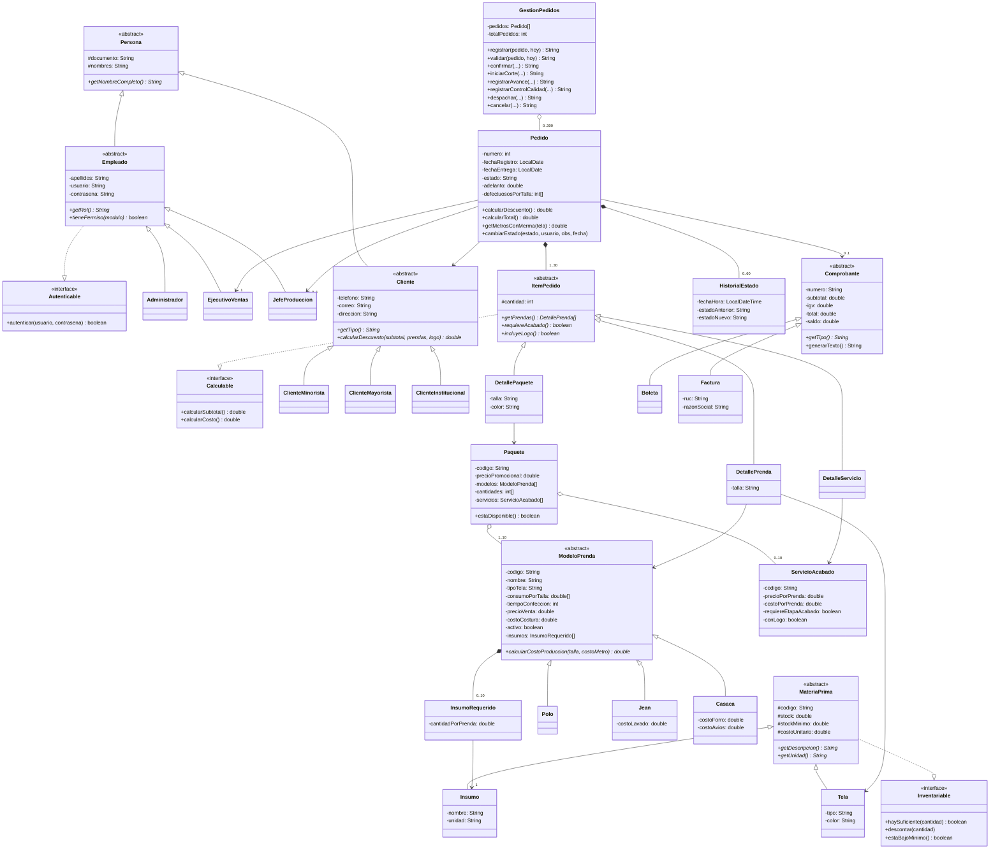

# Diagrama de clases (UML)

GitHub dibuja este diagrama automáticamente. Para el informe se puede exportar desde https://mermaid.live (pegar el bloque).
Se muestran los atributos y métodos más relevantes; getters y setters se omiten.

Las demás clases `Gestion*` (`GestionEmpleados`, `GestionClientes`, `GestionModelos`, `GestionTelas`, `GestionInsumos`, `GestionServicios`, `GestionPaquetes`, `GestionComprobantes`) siguen el mismo patrón: un arreglo de su entidad, un contador y los métodos `buscar`, `registrar`, `actualizar` y `eliminar`. `SistemaTextil` guarda una instancia de cada gestor para que todas las ventanas compartan los mismos datos.
